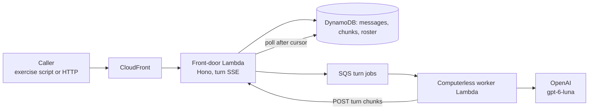
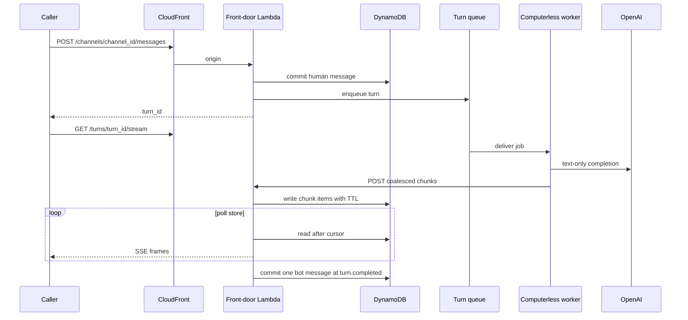
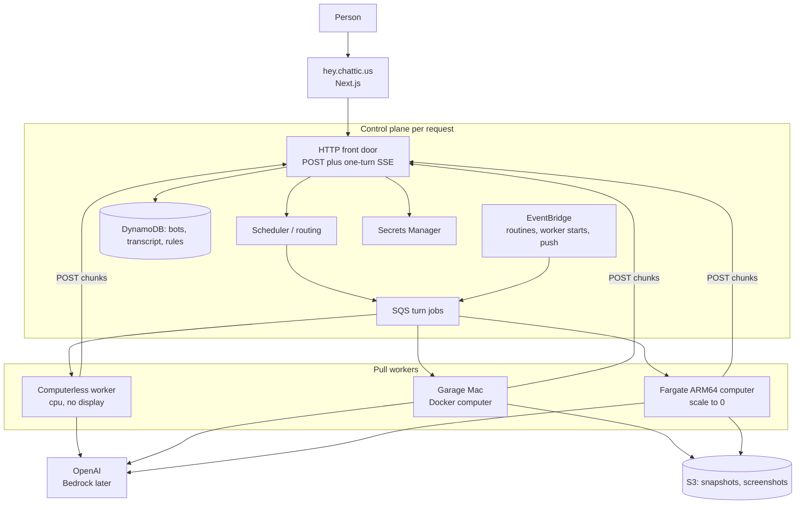

# Chatticus

**Shared spaces for people and bots.**

Chatticus is a shared, collaborative space where people and named bots
work together around common files, tools, and a system of authority and
approvals — like an office, not a chat window.

The production product workspace is [hey.chattic.us](https://hey.chattic.us).
The public marketing site, [chattic.us](https://chattic.us), is a separate
private repo (`AnthusAI/Chattic.us-web`) that depends on this repo's shared
UI kit and brand tokens; see the `exports` map in [package.json](package.json)
and Kanbus epic `chatticus-3926bc` for the public/private boundary.

v1 is personal: one household, one AWS account, as many named bots as we
want. Every record already carries a `tenant_id` so the same system can
later serve other people without a rewrite.

## Named teammates and one computer

A **bot** is a persistent, named teammate. It keeps memory, preferences, and
conversation. It is not a fresh chat session on every task.

A **computer** is a Linux workplace with a browser, a filesystem, and a
terminal. It belongs to a **user**, not to a bot. Every bot on that user
shares `/workspace`, browser sessions, and command-line credentials so they
can hand work off. Each bot gets its own screen so they can work in parallel.
Separate bots are not a security boundary.

Work prefers **structured tools** (APIs, MCP servers, connectors) when they
exist. The computer's browser is the fallback for sites and apps that have no
clean API.

A **skill** is how to do a task. A **routine** is when to run it (a schedule
or an event). **Approvals** stop consequential actions: sending, purchasing,
publishing, deleting, and production changes.

Closing your laptop does not stop work. The computer runs on a worker, not
on the device in front of you.

## How a turn works

A **turn** is one bot response: from a human message (or a routine) until
the control plane commits a single bot message to the transcript.

There are no persistent sockets. The browser **POSTs a message** and then
reads **server-sent events scoped to that one turn**. Reconnecting is a new
SSE request that reads already-committed chunks after `Last-Event-Id`.
In-process queues are not the architecture.

The **control plane** is the AWS side that accepts HTTP, stores tenant
state, and enqueues jobs. It does not run the model loop and it does not
own a display. It holds no always-on process in the token path, so when
nobody is working, nothing bills. That idle floor is the point: a quiet
household (and later, quiet tenants) should not pay for capacity that is
sitting empty. There is never a load balancer in front of the API; an
hourly LB charge would recreate the floor this design avoids.

**Pull workers** register, heartbeat, and take jobs from a queue. The
control plane never SSHs into a garage Mac. A worker that has CPU and
network but no display, browser, or `/workspace` is **computerless**.
Text-only turns can finish there. The computer is **summoned when a tool
needs it**, not assumed at enqueue: reaching for a display, browser, or
`/workspace` escalates the same turn onto a computer-capable worker. No
second transcript.

See [Architecture](docs/ARCHITECTURE.md) for routing,
[Messaging](docs/MESSAGING.md) for the transcript and stream, and
[Design challenges](docs/DESIGN_CHALLENGES.md) for rejected alternatives.

## What is live today

**Last updated: 2026-10-15.** `develop` was merged into `main`; release
**v0.44.0** is published (release commit `4bc44d8b`). It was cut by running
semantic-release locally as the owner, because the Actions release job could
not push to `main` while it was briefly protected (GH006). That protection
was applied in error and has been removed: by decision of the owner
(2026-10-15), `main` has no branch protection and the `staging` and
`production` environments have no required reviewers; they keep only a
deployment branch policy that allows `main` only.

### Staging and the marketing site moved into the production AWS account

There is no separate staging AWS account. **Staging** now runs in the production
account as `Staging`-suffixed stacks (`AccountDeployStaging`, `SnapshotsStaging`,
`ComputersStaging`, `EnvironmentZonesStaging`, `EnvironmentCertificatesStaging`,
`ThinTurnStaging`, `ControlPlaneStaging`, `AuthStaging`, `WebStaging`), and
`staging.chattic.us` serves 200. Production keeps its existing stack names. The
old staging account's stacks are deleted; empty leftovers remain and the account
is not yet closed. **Limits:** staging computers are not available (no promoted
computer image), the staging integration test principal is not wired (staging
acceptance fails with 403 on bearer exchange), and the staging deny policy is
not yet on the production deploy role.

The **marketing site** (`chattic.us` and `www`) is now served from the production
AWS account by the `ChatticusMarketing` stack in the private website repo, with
its own intake Lambda, DynamoDB table and SES, instead of proxying to this repo's
thin-turn. Waitlist and contact leads are recorded. **Limit:** SES production
access was denied (sandbox), so confirmation emails reach only verified
recipients until an appeal succeeds. Legacy marketing and thin-turn resources
are unused but not yet deleted. Deploy workflows for staging and production are
`workflow_dispatch` only.

### The control plane is TypeScript on `develop`

The Python tree is deleted from `develop` (Kanbus chatticus-f27222). The
control plane is the TypeScript service in `conversation/`, built on Pi-durable
(see [Pi harness](docs/PI_HARNESS.md) and
[TypeScript control plane](docs/TYPESCRIPT_CONTROL_PLANE.md)). The **development**
environment runs it, and the computer path is proven live there. **`main` now carries the TypeScript
control plane (v0.44.0) and staging runs it in the production account;
production has not been cut over**, so do not assume production behaves like
development. Existing transcripts need the migration runbook (the design's
cutover and rollback sections) before production moves.
The Gherkin features run under cucumber-js with TypeScript steps. The sections
below that predate this change describe the Python-era stack on the environments
that still run it.

### Credential renewal is live on development (Phase 2b)

On **development only**, a long-lived computer owner no longer stops when its
first credentials run out. Owner credentials last 8 hours. The supervisor
renews them in place 1200 s before expiry, swaps them atomically, and stops
itself with reason `credentials` if renewal keeps failing, so the next message
starts a fresh owner. The per-turn child reads its credentials over a socket to
the supervisor and holds none in its environment. A development-only broker
fault switch (`deny_supervisor_renewal`, behind four gates) exists to rehearse
the failure path. Verified live on development: an 81 minute run on one owner
task with renewals at minute 40 and minute 80 and turns served after minute 63,
and a forced-denial run that drained at 600 s remaining and exited with code 5.
Not yet done: raising the owner minimum protocol version and the final docs
pass (Kanbus chatticus-3a31bb, chatticus-816a1a). Staging and production do not
run this path.

### The computer runs Pi on development (Pi session handoff)

For computers in Anthus's own AWS accounts, the Lambda runs Pi until the first
computer tool call, parks the turn, and the ComputerStarter runs a Fargate owner
task. A Pi owner in that container claims the parked turn (same session, new
fence), runs Pi's own `read`, `write`, `edit` and `bash` locally, calls the model
through a gateway route with a per-turn token (the real OpenAI key stays in the
control plane), publishes the workspace snapshot when content changed, and (Phase 2a) stays up as a long-lived supervisor that serves further turns, polling for parked turns with a 1 s to 3 s backoff and exiting after a 900 s idle timeout; verified live on development: one owner served two back-to-back turns, while idle shutdown with a published snapshot, crash recovery and drain are not yet proven live.
Model-chosen commands run as an unprivileged user (uid 2000) with a scrubbed
environment. Rehearsed live on **development only**: a smoke turn, a security
check, a recovery after the owner task was stopped mid-command, and a bug-fix
task that persisted to a fresh owner. Computers in a customer account never get
Pi; they keep the HTTP host protocol and the host worker. See
[Pi session handoff](docs/PI_SESSION_HANDOFF.md) for the design, proof and the
**limits**: staging and production do not run this path; the container
credentials endpoint cannot be blocked on Fargate (mitigated by an empty task
role, not blocked); credentials and the gateway token last one hour with no
refresh; the gateway has a model allow-list, request limits and a monthly
model spend ceiling per organization (see below); `browse` has no executor on the owner path; and the old
own-account Fargate host task definition and service were removed from the
Computers stack (PR 518, deployed 2026-10-12).

The development environment is **[develop.chattic.us](https://develop.chattic.us)**
in the `chatticus-development` account. `dev.chattic.us` is the stale legacy
deployment; older proofs below that name it ran there.

### Model spend ceiling and clean-exit disk state (development only)

On **development only**, the model gateway refuses a call once an organization
has spent its monthly model budget: USD 25.00 per organization per UTC month by
default, overridable with `CHATTICUS_MONTHLY_MODEL_SPEND_CEILING_USD` (PR 562,
Kanbus chatticus-f34796). Over the ceiling the gateway returns 403
`model_spend_ceiling_reached` and the caller does not retry. If spend cannot be
read it fails closed with 503 `model_spend_unavailable`. It is separate from the
AWS spend ceiling, needs no IAM change, and is only as fresh as the cost index
(see [Cost accounting](docs/COST_ACCOUNTING.md) section 3.12). The ceiling is not
yet settable per organization, not shown on the Costs tab, and does not count the
current turn's unreconciled calls. Also on development, a clean owner exit with
unchanged content now clears `disk_dirty`: the supervisor reports
`disk_matches_published` on its stopped report and the Front Door clears the flag
in the same write (PR 561, Kanbus chatticus-0ccf0b), so the next start no longer
re-hydrates an identical snapshot. Staging and production do not run this path.

### Live file view and edit on development (Phase 3, 2026-10-13)

Members can view and edit a computer's files whether or not the computer is
running (Kanbus `chatticus-041a10`, PRs 519 to 532; contract in
[Live files protocol](docs/LIVE_FILES_PROTOCOL.md)). With the computer off,
edits, deletes, renames and new folders go to an edit overlay in the snapshot
bucket (written only by the Front Door with conditional puts) and the next
owner applies them at hydrate. With the computer on, the owner serves them
through the unprivileged file helper. Saves carry If-Match; a stale hash is
refused with 409. Proven live on development with API calls: offline folder
and file create, rename and a stale 409; the next turn on a fresh computer
sees the offline edit; online read, edit, bot read-back, delete, stat 404; a
stale save after a bot edit is refused 409 and the bot's line survives;
If-Match and ETag pass through CloudFront. **Not yet proven:** the Files panel
in a browser at 375 px or with a real signed-in user (`chatticus-bf7fd2`);
container memory at 512 MiB under two helpers, a Pi turn and a publish
(`chatticus-7c6040`). **Known gaps:** a read of a pending offline edit labels
its source snapshot where the contract says overlay (`chatticus-5dbb7e`); the
live audit cannot tell file hashes from folder tree hashes (`chatticus-f9cfda`);
files over the 8 MiB live limit and a 2000-entry listing in one table item are
unmonitored (`chatticus-e7a52f`); customer-account computers remain view-only
(`chatticus-ed8e4e`); staging also enables the integration test principal
(`chatticus-80b17c`). Staging and production do not run this path. Incident:
pushing the image to development before the Front Door IAM was proven broke
every computer start there for about 40 minutes, because moto does not enforce
IAM; a pre-deploy IAM check is tracked in `chatticus-d88a0f`.

### Cost records on development (2026-10-13)

Every model call a turn makes is priced and written into the durable Pi session
as a cost record (tokens including cached input, the price book version, and the
computed USD), keyed so a retry cannot double count. A per-turn index item sits
beside the session with the owner kind (`computer` or `lambda`), and the vendor
ledger row is projected from those records. Verified live on **development
only**: a computer-owner turn wrote 2 records (0.0001858 USD) and a Lambda turn
wrote 1 (0.000092 USD), the ledger row matched, and the earlier double count on
the computer-owner path is gone. The price book is versioned
(`openai@2026-10-13+pi-ai-1.0.2`). **Customer-visible on development only:** the cost HTTP API
(chatticus-09bef0, #541) and the web cost view (chatticus-f65e89, #542): a
Costs tab in the inspector (Context | Files | Costs), a cost chip in the header
of the open conversation, Triggered/Took markers under messages, an
organization month summary broken down by bot, conversation and model, recent
turns with Show more, a per-turn drill-down (per-call model, tokens, cache
reads and writes, tier, price book, dollars) and CSV export at turn and call
grain. Incomplete totals read "at least $x" with the count of unpriced calls;
unpriced calls are never shown as zero; estimated, gateway and voice rows are
labelled; money keeps sub-cent precision; a standing line says it is not a
bill. Verified live: the signed-in Costs tab opens on development and shows its
empty state for an organization with no new-format records. **Not verified:**
the populated view with real data in the signed-in workspace (only fixtures at
desktop and 375 px, light and dark), and the header chip and message markers in
a live thread (follow-up under `chatticus-8c857b`). **Not built yet:** compare
UI and export polish (chatticus-dffe56); per-sub-agent cost, since sub-agents
are not built (chatticus-24308d); legacy ledger migration (chatticus-0d265c),
so old ledger rows are not shown; compaction, aborted and uncommitted calls are
not metered beyond the documented caveats; rates come from the library's
bundled catalog and have not been verified against the vendor's published page.
Staging and production do not
record this. See [Cost accounting](docs/COST_ACCOUNTING.md) and Kanbus epic
`chatticus-8c857b`.

### Voice and turn failures on development (2026-10-04)

On `develop` and deployed to development only; not on `main`.

- **Voice control** (#385, chatticus-a8066a): the workspace listens on-device
  with Moonshine; nothing leaves the tab until a line is addressed to a
  teammate by name, and then it is an ordinary one-turn message. A small local
  command grammar runs without a bot. COOP/COEP headers are on the development
  distribution only (chatticus-604bb6). Design: [Voice](docs/VOICE.md).
- **Spoken replies** (#389, chatticus-12096f): while listening, the open
  conversation's reply is read aloud with browser `speechSynthesis`, cleaned
  of markdown and capped. "Stop" silences it hands-free, and other speech is
  ignored while it talks so the bot does not hear itself.
- **Failure you can see** (#387, #388): a permanent model-provider error fails
  the turn at once with a readable reason; the failed reply stays visible with
  that reason and a Retry; `GET /channels/{id}/turns/latest` recovers it; a
  slow turn shows a notice.
- **Model**: bot turns run on OpenAI `gpt-6-luna` at low reasoning; voice understanding uses `gpt-5-nano`.

Still open on voice (epic chatticus-628234): a 60-minute live-mic and battery
run, an iOS device test, and COOP/COEP against sign-in before staging and
production get the headers.

### Implemented locally, not yet merged or deployed

The `codex/real-chatticus-workspace-develop` branch contains the first real
application workspace milestone. It provides a full-viewport responsive shell,
a unified roster of persistent bots and named multi-bot channels, durable
conversation history, active-turn recovery and turn-scoped streaming, and a
collapsible inspector backed by current computer and task data. Direct bot
conversations have canonical identity; named channels store their name and
participants and expose an addressed-bot selector.

This work is still under local verification. It is **not** on `develop` and has
not been verified on `dev.chattic.us`. The development audit found 180 legacy
channel rows: 178 direct candidates, no multi-bot named candidates, two
human-only invalid empty channels, and one duplicate direct identity for
AcceptLoopBot spanning five channels and 12 messages. The one-pass migration was
applied on 2026-09-10: the empty invalid identities were removed, all 12 messages
were preserved in one canonical direct channel, and the post-migration audit
found no remaining legacy, invalid, or duplicate-direct groups. Routines, bot
configuration, approvals, live computer screenshots or controls, and separate
Tasks, Computer, Settings, or Plugins destinations remain deferred.

### Deployed across environments

| Environment | ThinTurn API (enforcement) | Cognito Auth (sign-out) | Web bundle |
| --- | --- | --- | --- |
| development (`develop.chattic.us`) | Live — CloudFront → Lambda | Live — `logoutUrls` + `/auth/signout-callback` | Live — product `/chat` at `/` (CF enabled; marketing moved to `AnthusAI/Chattic.us-web`, chatticus-3926bc) |
| staging (`staging.chattic.us`) | Live — Lambda URL | Live — `logoutUrls` + callback | Deployed — S3 bundle staged, **CF dark by design** |
| production (`hey.chattic.us`) | Live — Lambda URL | Live — `logoutUrls` + callback | Deployed — S3 bundle staged, **CF dark by design** |

Staging and production thin-turn stacks may lag `develop`; their web front doors
stay dark until explicitly re-enabled and re-proven.

Every org route requires a Cognito `id_token` or worker bearer on all three
environments; only `/health` and `POST …/workers/register` (invoke-key gated)
are open. Live-verified on each environment: `/health` 200, `/me` 403, org
route 403 with no credential.

A seeded owner (`ryan@anth.us` → org `anthus`, display name Anthus AI
Solutions, enabled) can sign in with Google on development and reach the
workspace. Operator org records are DynamoDB data, not CDK; see
[Operator org seed](docs/OPERATOR_ORG_SEED.md).

### Live on development (beyond the table)

- **Operator org lifecycle HTTP** (#304): enable, suspend, and reinstate on
  development ThinTurn. Endpoints and auth are in
  [Operator org seed](docs/OPERATOR_ORG_SEED.md).
- **Customer cross-account template** (#308): `infra/customer-role.yml` is
  published at
  `https://develop.chattic.us/provisioning/customer-role.yml` (SSM:
  `/chatticus/development/provisioning/customer-role-template-url`). Runbook:
  [infra/README.md](infra/README.md). Staging and production hostnames stay
  CF-dark; do not treat their template URLs as a customer onboarding path yet.
- **Throwaway-account hand run** (`chatticus-b88c0a`): published template
  unmodified; F-safe `pong` completed on development. Timed runbook:
  [wiki](project/wiki/runbooks/throwaway-account-provisioning.md)
  (~19 min Chatticus provision; consumer AWS signup unmeasured). That
  figure **excludes** F-computer.
- **F-computer live refuse** (`chatticus-2f2d87`, closed): ComputerWorker
  assumed the customer role; missing customer `ChatticusComputers`;
  **zero `RunTask` in both accounts**. Kernel handoff ~5 s.
- **Customer-account `RunTask`** (`chatticus-82dab7`, #312–#315, closed):
  product `CreateStack` of `ChatticusComputers` in the customer account;
  lab-user customer `RunTask ≥ 1`.
- **Customer host executes `browser_open`** (`chatticus-8fe4c7`, #319, closed):
  kernel `about:blank` on development (labeled deviation from the customer
  UI). Journal `opened:about:blank`. Customer `RunTask` 1, Anthus 0. Host
  talks to Front Door HTTP only. Do not fold that elapsed time into the ~19 min
  provision figure.
- **Customer ECR holds `:dev`** (`chatticus-2b3c41`, #320, closed): task
  definition pulls from the organization AWS home. Operator
  `push-customer-computer-image.sh` published `:dev` under the assumed role
  (not Lambda). Anthus `ChatticusComputers` desiredCount stays 0. Live
  file-actions (2026-09-08) required a **repush** after host executor
  wiring; stale `:dev` failed with `HOST_IMAGE_STALE_CHROMIUM_EXECUTOR_ONLY`.
- **Agent workplace files survive host recycle** (`chatticus-863f27`,
  #324, closed): live on the throwaway org (kernel deviation). Write →
  customer-bucket publish → stop/start → read. Journal
  `persisted-by-agent-live-863f27`. Packs in
  `chatticus-snapshots-{ORGANIZATION_ID}`. Do not fold elapsed time into
  the ~19 min provision figure.

### On `develop`, not on `main`

- **Organization computer in the customer AWS home** (#306): host start routes
  through the org's recorded AWS account and cross-account role; same-account
  orgs use deployment credentials; unreachable customer roles refuse without
  Anthus fallback. Covered in Gherkin (`cross_account_provisioning.feature`,
  `computer_ecs_host_starter.feature`).
- **ECS host start** is wired on **development ThinTurn only**
  (`CHATTICUS_HOST_STARTER=ecs`). Staging and production ComputerWorker keep
  the no-op host starter.
- **Customer Fargate host on development** (#319): `computer_host_worker`
  uses Front Door `/host-worker/*` (no Dynamo on the customer task role).
  Live `browser_open` / `about:blank` completed on the ACME throwaway
  account. Staging and production ComputerWorker still use the no-op host
  starter. Image pull is the customer ECR `:dev` (#320).
- **Agent workplace files on host disk** (#318–#324, `chatticus-fccc4e9a`
  closed): Dynamo snapshot metadata, host hydrate/publish, host
  `read_workspace`/`write_workspace`, customer org bucket, and Gherkin
  that an agent file survives relocate
  (`computer_host_workspace_recycle.feature`). Live throwaway proof is
  under **Live on development** above. Do not `cdk deploy --all`.
- **Pending and enabled members see org name, status, and tenant_id**
  (#325, `chatticus-9c8dbf`): `GET /me` includes `name`; welcome and
  workspace list CloudFormation `OrganizationId` without the members CLI.
  Live on development after the web deploy from this merge.
- **Pending owners submit cross-account RoleArn in-product** (#326,
  `chatticus-070cb4`): `POST /orgs/{tenant_id}/self-setup/cross-account-role`.
  Live on development: inspect 422 when ExternalId does not match; 403
  without a user token. Operator enable stays break-glass without AWS
  home.
- **Enabled members create a named bot in the workspace** (#327,
  `chatticus-7622fd`): `CreateBotPanel` → `POST /bots` → roster refresh.
  Live on development: `LiveCreate` **200** and listed. Google SPA
  sign-in still blocks automated UI; HTTP path is live.
- **Human-started turns attach a household conversation grant** (#328,
  `chatticus-5336ff`): `read_workspace` and `write_workspace` on
  `/workspace` plus `approved_origin_fetch`. Live on development: human
  message to Ping HTTP 200; Dynamo turn grant matched the preset.
  `POST /bots` still attaches nothing until that first human message. No
  browse, send, purchase, or `run_terminal` in the preset.
- **Enabled members replace an active turn grant over HTTP** (#331,
  `chatticus-be3997`): `PUT /orgs/{tenant}/turns/{id}/grant` on the
  user route. Live on development: member PUT replaced a Ping turn grant
  with `browse` + origin only (no union with the conversation preset).
  Unauthenticated and worker bearer PUT 403.
- **Enabled members replace an active turn grant from the product
  workspace** (#333, `chatticus-753bd8`): `TurnGrantPanel` ("Authorize
  this turn") when a turn is active; full closed replace via the same
  user PUT. Tools offered: browse, read/write workspace, `run_terminal`
  **default off**. No send/purchase. Live on development: SPA bundle on
  `dev.chattic.us` includes the panel (`aa118e8` /
  deploy-web-development 34256447742). Google SPA sign-in still blocks
  automated UI click-through (same as create-bot); Gherkin harness is the
  automated gate.
- **Per-task `run_terminal` via human grant replace** (#335,
  `chatticus-7fe070`): conversation preset stays `read_workspace` and
  `write_workspace` only (no `run_terminal`). An enabled member
  HTTP-replaces the active turn grant with a closed grant that includes
  `run_terminal` and `/workspace`; policy allows the attempt (computerless
  continuation queued, waiting on workspace). Gherkin:
  `per_task_run_terminal_grant.feature`.

### Public sites

| Host | Role | Notes |
| --- | --- | --- |
| [chattic.us](https://chattic.us) | Marketing (private `AnthusAI/Chattic.us-web` repo) | Updates, Agent Zoo, and the Markus wiki at `/wiki`; served from the production AWS account with its own intake (SES sandbox) |
| [develop.chattic.us](https://develop.chattic.us) | Development product + API | Same-origin `/api`; product `/chat` at `/` |
| [hey.chattic.us](https://hey.chattic.us) | Production product (planned) | Web CloudFront **disabled** (stack exists, dark) |
| [staging.chattic.us](https://staging.chattic.us) | Staging (production AWS account) | Serves 200; computers not available |

### Live acceptance gate

Live stack proof is manual: sign in at [develop.chattic.us](https://develop.chattic.us)
and send a message.

Named deploy workflows (`deploy-thinturn-development.yml`,
`deploy-web-development.yml`, `deploy-auth-development.yml`, and the matching
staging/production workflows) run on **push** to the environment branch
(`develop` for development) and on **`workflow_dispatch`**; the staging and
production workflows are `workflow_dispatch` only. GitHub Actions deploys to live AWS through OIDC
(`ChatticusGitHubDeploy` roles). Local `cdk deploy` via `infra/deploy-*.sh`
remains the fallback when CI cannot be used.

### Cloud stacks (do not destroy)

`ChatticusDns`, `ChatticusAuth`, `ChatticusWeb*` (development CF enabled; staging/
production CF disabled), `ChatticusThinTurn*`, `ChatticusSnapshots*`, `ChatticusComputers*`
(unsuffixed in development's account and in the production account, where production
is already live under those names; staging, which shares the production account, has
the `Staging` copies), `ChatticusBudgets` (one per account). Never `cdk deploy --all`. Computers `desiredCount` stays **0**.

### Kernel-only on `develop` (not on live worker loop)

Overnight gated-action, immutable approval binding, unbound-browser stops, computer-seam
recovery, capability-gated readiness beyond waiting turns, and structured handoff journal
events are tested in Gherkin/vitest but not wired into the live worker HTTP loop yet.
See [Approval spec](docs/APPROVAL.md) and [Organizations](docs/ORGANIZATIONS.md).





## Where we are going

v1 is the product Next.js app at `hey.chattic.us` (production) talking to that same per-request control
plane, plus pull workers that can stay computerless or host the user's
Linux computer: local Docker when a Mac is on, Fargate ARM64 that scales
to zero when it is not. Workplace disk lives in S3 snapshots. EventBridge
will wake routines later. The model vendor is OpenAI; Amazon Bedrock may
follow.

Lambda is the right runtime for HTTP, auth callbacks, webhooks, routine
wake-ups, a computerless model loop, and holding **one turn's** SSE
stream. It is the wrong runtime for a workplace: it cannot hold a browser,
a display, or a session-lifetime connection. The computer is one Docker
image on Fargate, later stop/start EC2, or Docker on a Mac.



How a turn chooses a host:

1. A message or routine creates a turn job with `tenant_id`, required
   capabilities (`cpu`, and maybe `computer` / `browser` / `terminal`), and
   an optional `computer_id` pin.
2. Healthy workers pull. Prefer an already-warm cheap host (local Docker
   when the Mac is on), then a warm AWS computer, then a cold Fargate start.
3. The model loop runs **on the worker**, as soon as it has network and
   memory. Display, Chromium, and snapshot hydrate gate only the actions
   that need them.
4. Reaching for a computer tool escalates the same turn: the computerless
   attempt appends the pending tool call and a computer-capable worker
   continues. There is no `stop_computer`; the workplace is shared by all
   of a user's bots.
5. At `turn.completed` the control plane commits **one** message row.

## Persistence

Compute and disk are separate. The **computer** is a `computer_id`. The
**host** is whichever Mac, Fargate task, or EC2 instance is running it.

Canonical workplace disk (`/workspace` and the browser profile) is an **S3
snapshot**. Hosts hydrate a local cache, run, and publish. Relocate is an
administrator action: point the next host at that snapshot. There is no live
container move. See [Computer snapshots](docs/COMPUTER_SNAPSHOTS.md).

| State | Where it lives |
| --- | --- |
| Bot memory, skills, routines | DynamoDB |
| Transcript (append-only messages) | DynamoDB |
| In-flight turn chunks | DynamoDB, with a TTL; they expire after the turn commits |
| `/workspace` and browser profile | S3 snapshot; local volume / EBS / EFS as a host cache |
| Secrets | AWS Secrets Manager, never in the image |

Computer policy: `prefer_local`, `aws_only`, or `local_only`. Idle AWS
computers stop (EC2) or scale to 0 (Fargate). The snapshot stays.

## Repository

```
Chattic.us/
  features/                 Shared Gherkin (product narrative)
  conversation/             TypeScript control plane, workers, snapshot packer, tools
  host-protocol/            Shared host protocol
  web/                      Marketing (`/`) and product workspace (`/chat`)
  computer/                 Linux computer image and host worker
  infra/                    AWS CDK
  docs/                     Product, architecture, design challenges, stack
```

Everything is **TypeScript**. Gherkin in `features/` is the behavior spec. Root
`package.json` workspaces (`web`, `infra`, `conversation`, `host-protocol`,
`computer/host`) mean one `npm install` at the repo root installs all
dependencies (Node 22+).

## What you can run today

Local JavaScript setup (Node 22+):

```bash
npm install
npm run build
npm run test
npm run lint
npm run dev
```

The `conversation/` tests and cucumber-js features (CI uses a fake OpenAI
client; a live key is not required) run against a moto container. Start it with `npm run moto:start` (port 5555, image pinned to
`motoserver/moto:5.2.3`), then from `conversation/` run `npm test` and
`npm run test:features`. Set `CHATTICUS_TEST_AWS_ENDPOINT` to use another port.
`features/cucumber-features.txt` is the list of features cucumber-js runs.

The deployed thin turn is exercised against a **named cloud environment**
(CloudFront on development only today), not against an in-process queue.
GitHub CI (vitest, cucumber-js) uses in-memory stores and moto. Live stack
proof is manual: sign in at [develop.chattic.us](https://develop.chattic.us) and
send a message.

The human-facing chat CLI (`conversation/bin/chat.ts`) is a stub that exits with
a message; use the workspace at [develop.chattic.us](https://develop.chattic.us)
or `conversation/bin/acceptance.ts --environment development` for the black-box
check.

That resolves the front door from `CHATTICUS_DEVELOPMENT_BASE_URL`, SSM
`/chatticus/development/thin-turn/cloudfront-url`, or the
`CloudFrontUrl` output on stack `ChatticusWeb` (or `ChatticusThinTurn`
before the web stack exists). When AWS lookup fails, pass `--base-url` or
set the env var (see gitignored `AGENTS.local.md`). SQS queue checks
need that same AWS identity. Staging and production web CloudFront is
disabled; use thin-turn stack outputs or `AGENTS.local.md` when you mean
those environments. It does not scale Fargate. Do not run this from
GitHub Actions.

If Docker Desktop is running, the snapshot packer can be checked with
`sh computer/test_relocate.sh`.

AWS resources are CDK only (`infra/`). Do not create them in the console.
`cdk deploy --all` would touch every snapshots and computers stack and every
thin-turn environment; never do that.
Deploy one named stack:

Deploy development ThinTurn only:

```bash
cd infra
sh deploy-chatticus-thinturn-development.sh
```

That fails closed without AWS identity and never passes `--all`. Staging
and production, when you mean those stacks:

```bash
npx cdk deploy ChatticusThinTurnStaging
npx cdk deploy ChatticusThinTurnProduction
```

**ChatticusThinTurn** is development. Staging and production are separate
stacks with their own DynamoDB, SQS, Lambda, and CloudFront (web CF
disabled on staging and production). Do not merge `develop` to `main` as
parking. Do not destroy the snapshot, computer, or budgets stacks.

Postgres in `docker-compose.yml` is unused (it predates DynamoDB).

## Task tracking

This repository uses [Kanbus](https://github.com/AnthusAI/Kanbus). Prefer
`kbs` when it is on `PATH`. See [CONTRIBUTING_AGENT.md](CONTRIBUTING_AGENT.md).

```bash
kbs list
kbs create "Describe the work" --type task
```

At **every milestone** (a slice merged to `develop`, a promote to `main`, a
deploy, a closed epic, or anything that changes what is true), **launch a
sub-agent** whose only job is housekeeping. That agent comments on the
Kanbus issues it touches, sets statuses to match reality, **creates new
issues** for significant work that appeared, and **rewrites the "What is
live today" section of this README** (and the next-up line) so a new reader
is not looking at last week's world. Do not skip that pass. Do not treat it
as a leftover for the implementation agent.

## Documentation

- [Product](docs/PRODUCT.md)
- [Architecture](docs/ARCHITECTURE.md)
- [Messages and the cloud API](docs/MESSAGING.md)
- [Design challenges](docs/DESIGN_CHALLENGES.md)
- [Computer snapshots](docs/COMPUTER_SNAPSHOTS.md)
- [Pi session handoff](docs/PI_SESSION_HANDOFF.md) (how a turn is handed from the Lambda to a Pi owner in the computer container, with diagrams, proof and limits)
- [Long-lived computer, file protocol and preview](docs/LONG_LIVED_COMPUTER.md) (PROPOSED design: an owner that stays up and idles out, viewing and editing the computer's files, a browser-tab preview of a dev server)
- [Stack](docs/STACK.md)
- [Roadmap](docs/ROADMAP.md)
- [Approval spec](docs/APPROVAL.md)
- [Browser authority](docs/BROWSER_AUTHORITY.md)
- [Threat model](docs/THREAT_MODEL.md)
- [Tasks](docs/TASKS.md)
- [Feasibility tests](docs/FEASIBILITY_TESTS.md)
- [AGENTS.md](AGENTS.md) for coding agents working in this repo
