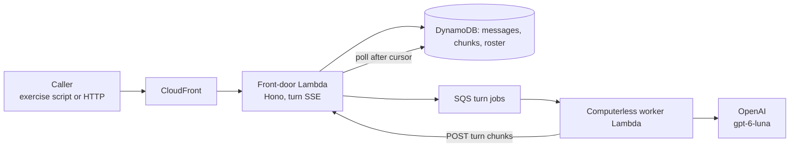
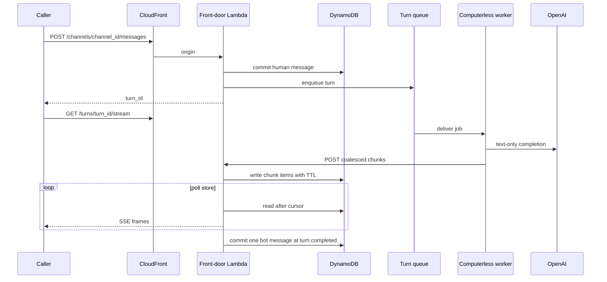
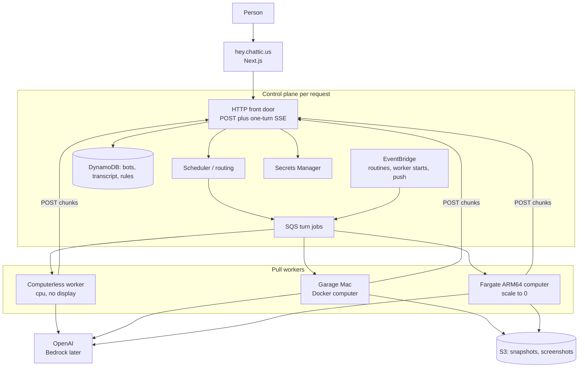

# Chatticus

**Shared spaces for people and bots.**

Chatticus is a shared, collaborative space where people and named bots
work together around common files, tools, and a system of authority and
approvals — like an office, not a chat window.

The production product workspace is [hey.chattic.us](https://hey.chattic.us).
The public marketing site, [chattic.us](https://chattic.us), is a separate
private repo (`AnthusAI/Chattic.us-web`) that depends on this repo's shared
UI kit and brand tokens; see the `exports` map in [package.json](package.json)
and Kanbus epic `chatticus-3926bc` for the public/private boundary.

v1 is personal: one household, one AWS account, as many named bots as we
want. Every record already carries a `tenant_id` so the same system can
later serve other people without a rewrite.

## Named teammates and one computer

A **bot** is a persistent, named teammate. It keeps memory, preferences, and
conversation. It is not a fresh chat session on every task.

A **computer** is a Linux workplace with a browser, a filesystem, and a
terminal. It belongs to a **user**, not to a bot. Every bot on that user
shares `/workspace`, browser sessions, and command-line credentials so they
can hand work off. Each bot gets its own screen so they can work in parallel.
Separate bots are not a security boundary.

Work prefers **structured tools** (APIs, MCP servers, connectors) when they
exist. The computer's browser is the fallback for sites and apps that have no
clean API.

A **skill** is how to do a task. A **routine** is when to run it (a schedule
or an event). **Approvals** stop consequential actions: sending, purchasing,
publishing, deleting, and production changes.

Closing your laptop does not stop work. The computer runs on a worker, not
on the device in front of you.

## How a turn works

A **turn** is one bot response: from a human message (or a routine) until
the control plane commits a single bot message to the transcript.

There are no persistent sockets. The browser **POSTs a message** and then
reads **server-sent events scoped to that one turn**. Reconnecting is a new
SSE request that reads already-committed chunks after `Last-Event-Id`.
In-process queues are not the architecture.

The **control plane** is the AWS side that accepts HTTP, stores tenant
state, and enqueues jobs. It does not run the model loop and it does not
own a display. It holds no always-on process in the token path, so when
nobody is working, nothing bills. That idle floor is the point: a quiet
household (and later, quiet tenants) should not pay for capacity that is
sitting empty. There is never a load balancer in front of the API; an
hourly LB charge would recreate the floor this design avoids.

**Pull workers** register, heartbeat, and take jobs from a queue. The
control plane never SSHs into a garage Mac. A worker that has CPU and
network but no display, browser, or `/workspace` is **computerless**.
Text-only turns can finish there. The computer is **summoned when a tool
needs it**, not assumed at enqueue: reaching for a display, browser, or
`/workspace` escalates the same turn onto a computer-capable worker. No
second transcript.

See [Architecture](docs/ARCHITECTURE.md) for routing,
[Messaging](docs/MESSAGING.md) for the transcript and stream, and
[Design challenges](docs/DESIGN_CHALLENGES.md) for rejected alternatives.

## Hosts

All environments run in one AWS account (`us-east-1`).

| Host | Role |
| --- | --- |
| [hey.chattic.us](https://hey.chattic.us) | Production product workspace and API |
| [staging.chattic.us](https://staging.chattic.us) | Staging |
| [develop.chattic.us](https://develop.chattic.us) | Development |
| [chattic.us](https://chattic.us) | Marketing site (private `AnthusAI/Chattic.us-web` repo) |

Deployment is described in [AGENTS.md](AGENTS.md) and [infra/README.md](infra/README.md).
For live status, see the Kanbus board.

## The thin turn





## Where we are going

v1 is the product Next.js app at `hey.chattic.us` (production) talking to that same per-request control
plane, plus pull workers that can stay computerless or host the user's
Linux computer: local Docker when a Mac is on, Fargate ARM64 that scales
to zero when it is not. Workplace disk lives in S3 snapshots. EventBridge
will wake routines later. The model vendor is OpenAI; Amazon Bedrock may
follow.

Lambda is the right runtime for HTTP, auth callbacks, webhooks, routine
wake-ups, a computerless model loop, and holding **one turn's** SSE
stream. It is the wrong runtime for a workplace: it cannot hold a browser,
a display, or a session-lifetime connection. The computer is one Docker
image on Fargate, later stop/start EC2, or Docker on a Mac.



How a turn chooses a host:

1. A message or routine creates a turn job with `tenant_id`, required
   capabilities (`cpu`, and maybe `computer` / `browser` / `terminal`), and
   an optional `computer_id` pin.
2. Healthy workers pull. Prefer an already-warm cheap host (local Docker
   when the Mac is on), then a warm AWS computer, then a cold Fargate start.
3. The model loop runs **on the worker**, as soon as it has network and
   memory. Display, Chromium, and snapshot hydrate gate only the actions
   that need them.
4. Reaching for a computer tool escalates the same turn: the computerless
   attempt appends the pending tool call and a computer-capable worker
   continues. There is no `stop_computer`; the workplace is shared by all
   of a user's bots.
5. At `turn.completed` the control plane commits **one** message row.

## Persistence

Compute and disk are separate. The **computer** is a `computer_id`. The
**host** is whichever Mac, Fargate task, or EC2 instance is running it.

Canonical workplace disk (`/workspace` and the browser profile) is an **S3
snapshot**. Hosts hydrate a local cache, run, and publish. Relocate is an
administrator action: point the next host at that snapshot. There is no live
container move. See [Computer snapshots](docs/COMPUTER_SNAPSHOTS.md).

| State | Where it lives |
| --- | --- |
| Bot memory, skills, routines | DynamoDB |
| Transcript (append-only messages) | DynamoDB |
| In-flight turn chunks | DynamoDB, with a TTL; they expire after the turn commits |
| `/workspace` and browser profile | S3 snapshot; local volume / EBS / EFS as a host cache |
| Secrets | AWS Secrets Manager, never in the image |

Computer policy: `prefer_local`, `aws_only`, or `local_only`. Idle AWS
computers stop (EC2) or scale to 0 (Fargate). The snapshot stays.

## Repository

```
Chattic.us/
  features/                 Shared Gherkin (product narrative)
  conversation/             TypeScript control plane, workers, snapshot packer, tools
  host-protocol/            Shared host protocol
  web/                      Marketing (`/`) and product workspace (`/chat`)
  computer/                 Linux computer image and host worker
  infra/                    AWS CDK
  docs/                     Product, architecture, design challenges, stack
```

Everything is **TypeScript**. Gherkin in `features/` is the behavior spec. Root
`package.json` workspaces (`web`, `infra`, `conversation`, `host-protocol`,
`computer/host`) mean one `npm install` at the repo root installs all
dependencies (Node 22+).

## What you can run today

Local JavaScript setup (Node 22+):

```bash
npm install
npm run build
npm run test
npm run lint
npm run dev
```

The `conversation/` tests and cucumber-js features (CI uses a fake OpenAI
client; a live key is not required) run against a moto container. Start it with `npm run moto:start` (port 5555, image pinned to
`motoserver/moto:5.2.3`), then from `conversation/` run `npm test` and
`npm run test:features`. Set `CHATTICUS_TEST_AWS_ENDPOINT` to use another port.
`features/cucumber-features.txt` is the list of features cucumber-js runs.

The deployed thin turn is exercised against a **named cloud environment**
(CloudFront on development only today), not against an in-process queue.
GitHub CI (vitest, cucumber-js) uses in-memory stores and moto. Live stack
proof is manual: sign in at [develop.chattic.us](https://develop.chattic.us) and
send a message.

The human-facing chat CLI (`conversation/bin/chat.ts`) is a stub that exits with
a message; use the workspace at [develop.chattic.us](https://develop.chattic.us)
or `conversation/bin/acceptance.ts --environment development` for the black-box
check.

That resolves the front door from `CHATTICUS_DEVELOPMENT_BASE_URL`, SSM
`/chatticus/development/thin-turn/cloudfront-url`, or the
`CloudFrontUrl` output on stack `ChatticusWebDevelopment` (or `ChatticusThinTurnDevelopment`
before the web stack exists). When AWS lookup fails, pass `--base-url` or
set the env var (see gitignored `AGENTS.local.md`). SQS queue checks
need that same AWS identity. Staging and production web CloudFront are
enabled; use thin-turn stack outputs or `AGENTS.local.md` when you mean
those environments. It does not scale Fargate. The development and
staging deploy workflows run it automatically after each deploy through
`.github/workflows/acceptance-smoke-test.yml`, as the integration test
principal in `CHATTICUS_INTEGRATION_TEST_ALLOWED_ROLE_ARN`; it fails loudly
when that variable is not set for the GitHub environment.

If Docker Desktop is running, the snapshot packer can be checked with
`sh computer/test_relocate.sh`.

AWS resources are CDK only (`infra/`). Do not create them in the console.
`cdk deploy --all` would touch every snapshots and computers stack and every
thin-turn environment; never do that.
Deploy one named stack:

Deploy one development stack (all three environments are in the one production
AWS account; sign in with profile `chatticus-production`):

```bash
cd infra
sh deploy-chatticus-dedicated-account.sh development thin-turn
```

That fails closed without AWS identity and never passes `--all`. Staging
and production use the same script with their own name:

```bash
sh deploy-chatticus-dedicated-account.sh staging thin-turn
sh deploy-chatticus-dedicated-account.sh production thin-turn
```

**ChatticusThinTurnDevelopment** is development. Staging and production are separate
stacks with their own DynamoDB, SQS, Lambda, and CloudFront (web CF
enabled on staging and production). Do not merge `develop` to `main` as
parking. Do not destroy the snapshot, computer, or budgets stacks.

Postgres in `docker-compose.yml` is unused (it predates DynamoDB).

## Task tracking

This repository uses [Kanbus](https://github.com/AnthusAI/Kanbus). Prefer
`kbs` when it is on `PATH`. See [CONTRIBUTING_AGENT.md](CONTRIBUTING_AGENT.md).

```bash
kbs list
kbs create "Describe the work" --type task
```

At **every milestone** (a slice merged to `develop`, a promote to `main`, a
deploy, a closed epic, or anything that changes what is true), **launch a
sub-agent** whose only job is Kanbus housekeeping. That agent comments on the
Kanbus issues it touches, sets statuses to match reality, and **creates new
issues** for significant work that appeared. This README carries no status
section; the board is the record of what is live. Do not skip that pass. Do
not treat it as a leftover for the implementation agent.

## Documentation

- [Product](docs/PRODUCT.md)
- [Architecture](docs/ARCHITECTURE.md)
- [Messages and the cloud API](docs/MESSAGING.md)
- [Design challenges](docs/DESIGN_CHALLENGES.md)
- [Computer snapshots](docs/COMPUTER_SNAPSHOTS.md)
- [Pi session handoff](docs/PI_SESSION_HANDOFF.md) (how a turn is handed from the Lambda to a Pi owner in the computer container, with diagrams, proof and limits)
- [Long-lived computer, file protocol and preview](docs/LONG_LIVED_COMPUTER.md) (PROPOSED design: an owner that stays up and idles out, viewing and editing the computer's files, a browser-tab preview of a dev server)
- [Stack](docs/STACK.md)
- [Roadmap](docs/ROADMAP.md)
- [Approval spec](docs/APPROVAL.md)
- [Browser authority](docs/BROWSER_AUTHORITY.md)
- [Threat model](docs/THREAT_MODEL.md)
- [Tasks](docs/TASKS.md)
- [Feasibility tests](docs/FEASIBILITY_TESTS.md)
- [AGENTS.md](AGENTS.md) for coding agents working in this repo
