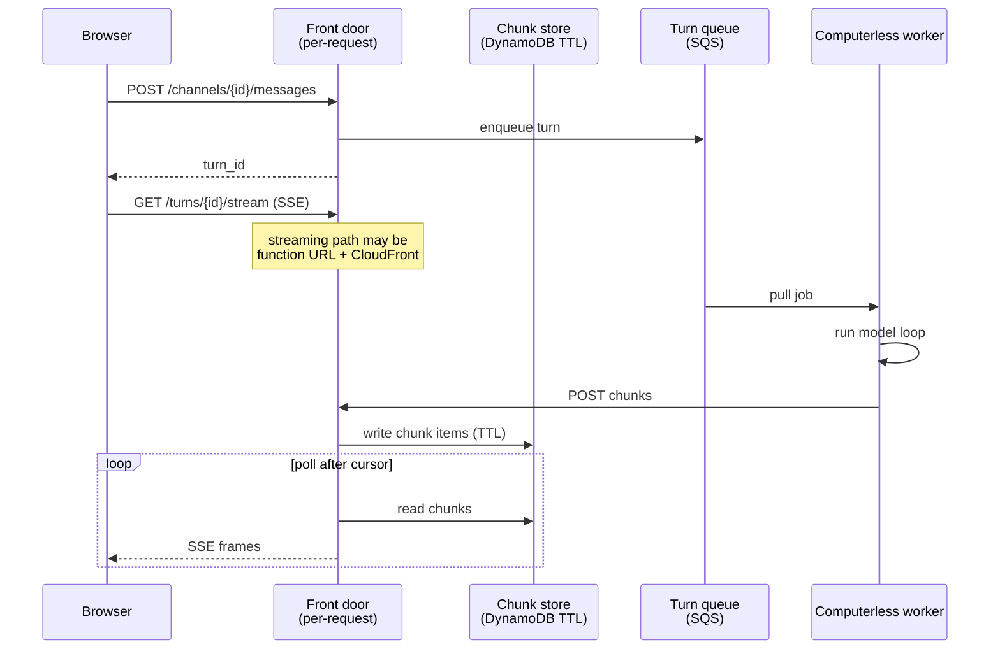

# Messages and the cloud API

This describes the decided design for the transcript and the streaming
path. The reasoning behind each choice, including what was rejected and
why, is in [Design challenges](DESIGN_CHALLENGES.md). The channel model is settled there;
this describes it.

Chattic.us is a conversation surface. The control plane is the only
thing that writes the transcript and the only thing the browser talks
to. Workers never notify the web app. Bots never HTTP-call each other.

**There are no persistent sockets in Chatticus.** Not from the browser,
not from the worker. Everything is a request, and the longest-lived
request is one turn.

## Message store

DynamoDB is the source of truth for conversations. S3 holds blobs
(screenshots, attachments). The computer snapshot is not the chat log.

A **channel** is one conversation. It belongs to one `tenant_id` and one
user. Participants are that human and one or more of that user's bots.

**Messages are append-only.** Each channel has a monotonically increasing
`seq`, assigned by the control plane at commit, which makes order within
a channel total. Clients reconnect with
`GET /channels/{channel_id}/messages?after=seq`. Edits and deletes are out
of scope for v1.

| Field | Role |
| --- | --- |
| `tenant_id` | Isolation. Required on every item. |
| `seq` | Per-channel order. Replay cursor. |
| `author_kind` | `human` or `bot` |
| `author_id` | `user_id` or `bot_id` |
| `body` | Committed text. Not a token. |
| `addressed_to_bot_id` | If set, the control plane enqueues a turn for that bot |

Files stay on the shared computer. A message may name a path under
`/workspace`. It does not copy the file into the transcript.

### A bot's input is memory plus the channel

A channel is shared; bot memory is not. They compose at turn start:

> **A bot's model input is its own memory plus the channel's compacted
> view.**

Every bot on a channel reads the whole channel. Only the addressed bot
acts. Bot memory is per-bot and spans channels; the channel is compacted
once and serves every participant. See challenge 4 in
[Design challenges](DESIGN_CHALLENGES.md).

### In-flight chunks live in the same store, with a TTL

A turn's partial output is not a message. It is a short-lived item keyed
by turn and sequence, carrying a TTL of hours, written by the worker and
read by whatever is streaming. At `turn.completed` the control plane
commits **one** message row with the joined text; the chunks then expire
on their own.

| Item | Lifetime | Written by |
| --- | --- | --- |
| Turn chunk | TTL, hours | Worker, through the front door |
| Committed message | Permanent | Control plane, at `turn.completed` |

Keep the two item types distinguishable so "messages are immutable and
permanent" has no asterisk. Do not insert a message row per token.

## Bot to bot

There is one message table. Bot-to-bot is not a second bus, queue, or
protocol.

1. A bot posts a message in a channel the human can already see.
2. The message is addressed to another bot on that channel.
3. The control plane enqueues a turn for the recipient, same as a human
   message would.
4. The recipient's worker pulls the job. It does not receive an inbound
   HTTP call from the other bot.

The human is not the router. The human still sees the same channel.

## The cloud API

Nothing bills while nobody is working. The API is per-request, and the
only thing that lives longer than a request is a turn.

The front door bills per request and has no hourly floor: an API Gateway
HTTP API, or a function URL behind CloudFront. **Never a load balancer.**
An ALB's hourly floor costs more than the always-on container this design
exists to avoid.

### How the web app is notified

1. The browser POSTs a message and gets back a `turn_id`.
2. It opens `GET /turns/{turn_id}/stream` and reads server-sent events.
3. The worker pulls the job, runs the model loop, and POSTs coalesced
   chunks (roughly every 250 milliseconds, not one per token). It starts
   the model loop as soon as it has network and memory; it does not wait
   for a display or a hydrated workspace it may never use.
4. The streaming function polls for chunks after its cursor and writes
   them out as events.
5. On `turn.completed` one message row is committed. The client reloads
   or reconciles with `GET .../messages?after=<seq>`.

The stream is scoped to **one turn**, not to the tab. Between turns the
browser holds nothing open, which is what lets the whole system reach
zero. A tab with no active turn learns about work finished by a routine
through device push, or a cheap "anything after seq?" poll every 20 to
30 seconds. Push cannot carry a token stream; it is only "come back,
something finished".

Streaming functions have a maximum duration (15 minutes on Lambda). A
longer turn ends the stream; the client reconnects with `Last-Event-ID`
and a fresh invocation resumes. Reconnect is a normal event, not an error
path.

The client should render each chunk smoothly across the following
interval. The up-to-250-millisecond delivery jitter is then invisible.

### Approvals travel by POST

Approvals are rare and human-initiated, so they do not need a duplex
connection. `approval.required` arrives on the stream (or on the next
poll); the human's decision is an ordinary POST. This is why
server-sent events are sufficient and a WebSocket is not needed.

### Events

| Kind | When | Stored as a message? |
| --- | --- | --- |
| `channel.message.created` | A row is committed | yes, that row |
| `turn.started` | A bot turn begins streaming | no |
| `turn.waiting` | The turn is blocked on a readiness gate, naming which (for example a computer still booting) | no |
| `turn.token` | One coalesced chunk | no |
| `model.request` | A fenced attempt issued a model call | no |
| `turn.thinking` | One coalesced piece of the model's reasoning summary, when the model streams one | no |
| `tool.call` | A tool request was committed, keyed by the Pi call id, with sanitized arguments | no |
| `tool.result` | A tool result was committed for that call id, with a bounded output | no |
| `computer.starting` | The turn parked for the organization's computer | no |
| `computer.ready` | An owner claimed the turn after that park | no |
| `attempt.claimed` | A worker became the fenced owner of the turn | no |
| `attempt.relinquished` | The previous owner dropped the fence before continuation | no |
| `turn.completed` | Chunks are joined into one row | yes, one row |
| `turn.failed` | The turn ended without an answer. `body` is a reason the member can read, for example that the model provider is out of quota | no |
| `turn.reconciling` | The outcome is uncertain; the client reloads committed state | no |
| `approval.required` | A proposed action is blocked | the proposal, not the action |

### What the activity events carry

Every event carries `kind`, `seq`, `event_id`, `turn_id` and `channel_id`. The events that describe what a bot is doing
add the fields below. Fields not listed for a kind are absent. An event stored before a field existed simply lacks it;
readers treat a missing field as absent.

| Kind | Fields |
| --- | --- |
| `tool.call` | `tool` (name), `call_id` (the Pi tool call id), `summary`, `arguments` (object), `arguments_truncated` (boolean) |
| `tool.result` | `tool`, `call_id`, `ok` (boolean), `summary`, `output` (text), `output_truncated` (boolean), `duration_ms` (number or null) |
| `turn.thinking` | `text` |
| `computer.starting`, `computer.ready` | `detail` |

`tool.call.arguments` is a sanitized copy, never the raw arguments:

| Tool | `arguments` | `summary` |
| --- | --- | --- |
| `run_terminal` | `command` (first 1000 characters) | `Running: <command, first 80 characters>` |
| `read_workspace` | `path` | `Reading <path>` |
| `write_workspace` | `path`, `bytes` (bytes of content), `preview` (first 200 characters) | `Writing <path> (<n> bytes)` |
| `edit_workspace` | `path`, `old_text` and `new_text` (first 300 characters each) | `Editing <path>` |
| `browse` | `url` | `Browsing <url>` |
| anything else | first-level strings cut to 300 characters, numbers and booleans as they are, at most 10 of them, nested values dropped | `Calling <tool>` |

Paths and URLs are cut at 500 characters. `arguments_truncated` is true when anything was cut or dropped.

`tool.result.summary` is `Exit <n>` for `run_terminal` (`ok` is true only for exit 0), `Edited <n> block` for a
successful `edit_workspace`, `Wrote <n> bytes` for a successful `write_workspace`, `Done` for any other success, and
`Error: <first 80 characters>` for a failure. `output` is the result text whole up to 3000 characters; a longer one keeps
its first 1500 and its last 1500 characters joined by `\n...[N characters omitted]...\n` and sets `output_truncated`.
`duration_ms` is measured by the attempt that saw the call start, so it is null when a call began under an earlier
attempt. `call_id` links a result to its call, and a call is journaled once however many attempts replay it.

`turn.thinking` is emitted only when the model streams a reasoning summary; nothing is invented when it does not. The
pieces are coalesced like `turn.token` and the turn carries at most 2000 characters of them in all.

`computer.starting` (`detail`: `Starting your computer`) is written when the turn parks for the computer, just before
`turn.waiting`. `computer.ready` (`detail`: `Computer ready`) is written by the first attempt that claims the turn after
that, right after its `attempt.claimed`.

Before any argument or output is placed in an event, every value in the process environment whose name is
`CHATTICUS_MODEL_GATEWAY_TOKEN`, `CHATTICUS_OWNER_HOST_TOKEN`, `AWS_SECRET_ACCESS_KEY` or `AWS_SESSION_TOKEN`, or contains
`KEY`, `TOKEN` or `SECRET` (values of at least 8 characters), is replaced with `[redacted]`. Each event stays well under
20 KB, far below the 400 KB item limit.

### Tool activity in the message list

`GET /orgs/{tenant}/channels/{id}/messages` gives every bot message an optional `activity` array: the tool calls the bot
made between the prompt and that answer, so the tool cards survive a reload. It is built from the committed Pi session,
which is permanent, not from the 24 hour events table, and the read-only Front Door builds it with no writes.

An item is the `tool.call` and the `tool.result` of one call in one object: `call_id`, `tool`, `summary`, `arguments`,
`arguments_truncated`, `ok` (boolean, or null when the session recorded no result), `result_summary` (the result's
`summary`, or null), `output` (text or null), `output_truncated` and `duration_ms`. Arguments and output come from the
same functions as the live events (`tool-event-fields.ts`), so the sanitising, the cuts and the secret scrub are the
same, and an item says what the live events of that call said. `duration_ms` is always null because the session stores
no timing.

Rules:

- The activity is attached to the bot's final answer of the turn, the message the channel log points at. It covers every
  call made after the bot's previous answer in its own session up to that answer, in call order, text-before-tool steps
  and steered messages included. A message with no tool calls has no `activity` field; human messages never have one.
  A turn that ended without any answer has no listed message of its own, so its calls are listed on the next answer.
- At most 50 items per message. A longer turn keeps its first 49 and ends with `{tool: "more", call_id: "more",
  summary: "<N> more tool calls", ok: null, ...}` where N counts the calls left out.
- At most 3,000,000 characters of activity in one response. When a list would exceed that, the oldest messages give up
  their activity first and the newest keep it, so the response stays far below the 6 MB Lambda limit however long the
  history. Activity is computed only for the messages the page returns, and `after` and `seq` behave as before.

### A failed model call fails the turn at once

When the model provider answers with an error that a retry cannot fix (the
account is out of quota, the key is rejected, the request is invalid), the
worker ends the turn through the fenced `POST /turns/{id}/failed` with a
member-facing reason, and the queued job is dropped. Temporary errors (rate
limiting, an unavailable provider, a network fault, or an error response
without the provider's error body) leave the turn active; the queue retries
it once the worker's lease expires. See `features/model_provider_failures.feature`.

### Waiting is a state, not dead air

A cold computer delays a bot's first *computer action*. It must not
delay the bot's first *word*. When a turn does block on a readiness
gate, it emits `turn.waiting` naming what it is waiting for, so the web
app can show "starting your computer" rather than a spinner that is
indistinguishable from a hang.

See challenge 5 in [Design challenges](DESIGN_CHALLENGES.md).

### The invariant

> The stream is ephemeral and fully re-derivable from the store. The
> work is durable and never depends on anyone watching.

A turn runs to completion whether or not a browser is attached. The
stream is a view, never a participant. If the stream ever carries state
that cannot be recovered through `Last-Event-ID`, reconnect becomes a bug
and the guarantee that closing the laptop does not stop work is gone.

### What the cloud API is not

- **No WebSocket**, browser-side or worker-side. A socket that lives as
  long as a chat tab needs a process that lives as long as a chat tab,
  which is the thing we are avoiding.
- **No load balancer.** Hourly floor, no idle scaling.
- **No EventBridge or SQS in the token path.** Both are the wrong shape:
  EventBridge cannot deliver into the invocation already holding the
  stream, and SQS consumes on delivery so it can neither fan out to two
  viewers nor be re-read on reconnect. See
  [Design challenges](DESIGN_CHALLENGES.md) for the full comparison.
- **No relational instance.** An always-on database would keep the meter
  running no matter how serverless the compute is.

EventBridge is right for coarse, per-turn signals where a second of
latency is invisible: routine wake-ups, starting a worker, and
`turn.completed` fanning out to device push. The line is: route what you
would wait a second for; buffer what you are rendering live.

### HTTP surface

| Path | Use |
| --- | --- |
| `GET /health` | Liveness; names the cloud environment (`development`, `staging`, `production`, or `local`) |
| `POST /bots` | Create a named bot. Retry with the same `Idempotency-Key` header returns the original bot |
| `GET /bots?user_id=&name=` | Look up a named bot after recycle |
| `GET /users/{user_id}/bots` | List a household user's named bots after recycle |
| `GET /users/{user_id}/channels` | List a household user's channels after recycle |
| `GET /users/{user_id}/computer` | Read the household computer (id, stopped, policy) after recycle |
| `GET /users/{user_id}/turns` | List a household user's in-flight turns after recycle |
| `GET /bots/{id}` | Read a bot, including isolated memory |
| `POST /bots/{id}/memory` | Persist one bot memory item |
| `POST /channels` | Open a channel. Retry with the same `Idempotency-Key` header returns the original channel |
| `GET /channels/{id}` | Read a channel record after recycle |
| `GET /channels/{id}/turn` | Read the active turn on a channel after recycle, including `waiting_for` when gated; **404** when none is active |
| `POST /channels/{id}/messages` | Human (or bot) commits a message; returns `turn_id` if a turn starts. Retry with the same `Idempotency-Key` header does not duplicate the message or enqueue a second turn |
| `GET /channels/{id}/messages?after=<seq>` | History and reconnect |
| `GET /turns/{id}` | Read a turn after recycle, including `waiting_for` when gated |
| `GET /turns/{id}/events?after=<seq>` | Durable turn journal after a seq |
| `GET /turns/{id}/stream` | Server-sent events for one turn (`Last-Event-ID`) |
| `POST /turns/{id}/chunks` | Worker appends coalesced output |
| `POST /approvals/{id}` | Human decides a blocked action |

### Computer files (read-only, from the published snapshot)

Under `/orgs/{tenant_id}/computer/files`, user-authenticated and checked like the
other organization routes: an enabled member of that organization, no other tenant.
The Front Door reads the computer's published snapshot (the manifest, the index it
names, and one ranged read of a file's gzip member) and writes nothing. Every
response carries `X-Content-Type-Options: nosniff`. Errors are
`{ "error": code, "message": text }`. Paths are API paths that must normalise under
`/workspace` (at most 1024 characters, no NUL, no `..`); `/workspace/src/a.c` is the
index entry `workspace/src/a.c`.

| Request | Answer |
| --- | --- |
| `GET .../computer/files?path=/workspace[/dir]` | `200 { source: "snapshot", as_of, path, truncated, entries: [{ name, path, kind, size, mode, sha256, link_target }] }`. `as_of` is the manifest's `published_at`. Directories first, then by name, at most 2000 entries (`truncated: true` beyond). `kind` is `file`, `directory` or `symlink`; `size` and `sha256` are set for files only, `link_target` for symlinks only, `mode` is octal permission bits like `"644"` |
| `GET .../computer/files/stat?path=` | `200 { source, as_of, entry }`; a symlink is shown as itself |
| `GET .../computer/files/content?path=&offset=0&length=262144` | `200 { source, as_of, path, size, sha256, encoding: "utf8"\|"base64", binary, offset, length, content, truncated, masked }` with `ETag: "<sha256>"`. `sha256` is of the whole file; `length` is the bytes returned (a text read never ends mid-character, so continue from `offset + length`). `length` over 262144 is `413 range_too_large`. Binary (a NUL byte or invalid UTF-8 in the first 8 KiB) is base64. A secret-looking file (`.env`, `.env.*`, `*.pem`, `*.key`, `id_rsa*`, `id_ed25519*`, `credentials`, `.netrc`, `.npmrc`, `*.p12`, `*.pfx`, anything under `.ssh/` or `.aws/`) is `masked: true` with `content: ""`; it is listed normally |

Errors: `400 invalid_path` / `invalid_range`; `404 no_snapshot` (the computer has never
published), `404 not_found`; `409 snapshot_not_indexed` (a snapshot made before
indexes existed); `413 range_too_large`; `422 not_a_file` (content of a directory),
`422 not_a_directory`, `422 too_many_symlinks`; `500 corrupt_snapshot` (the stored
bytes do not match the indexed SHA-256; no content is returned and an error line
`snapshot_member_corrupt` is logged); `503 snapshot_store_unavailable` (no snapshot
bucket configured). A symlink is followed on a content read only inside the index,
at most 8 hops, only to targets under `workspace/`. Authentication refusals keep
the shape of the other organization routes (`403` with `detail`).

## Decided: worker bearer credentials

Workers register at `POST /orgs/{tenant_id}/workers/register` and receive a
one-time bearer token. The control plane stores only a SHA-256 hash.
Worker routes require `Authorization: Bearer <token>`. The shared
`X-Chatticus-Invoke-Key` remains a CloudFront-to-Lambda gate and is not
caller identity.

## Still open

These are placement and configuration, not architecture:

- TLS and session handling on the stream request.
- Whether local `docker-compose` runs one process standing in for the
  front door while developing.
- The DynamoDB key structure, and whether chunks share a table with
  messages. See [Design challenges](DESIGN_CHALLENGES.md).

## Decided: same-origin front door

The browser reaches the thin-turn API at **`/api/*` on the same host**
as the Next.js app (e.g. `https://hey.chattic.us/api/channels/...` in
production). Each
named environment has **one CloudFront distribution** per web hostname:

- **Default behavior** — S3 origin for Next.js static assets.
- **`/api/*` behavior** — Lambda function URL origin (caching disabled;
  same SSE settings as the thin-turn spike). CloudFront strips the
  `/api` prefix before forwarding so FastAPI routes stay at `/channels`,
  `/turns`, and so on.

Workers and local acceptance may continue to call the function URL
directly; the public browser surface uses same origin only.
